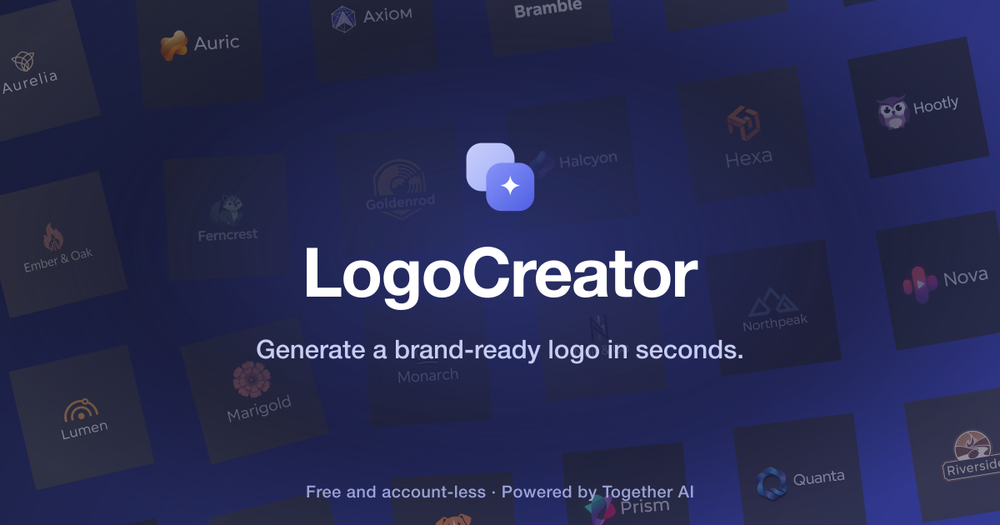

<a href="https://www.logo-creator.io">
  
  <h1 align="center">LogoCreator</h1>
</a>

  An open source AI logo generator: design a brand-ready logo in seconds, then export a full brand kit. Free and account-less.

## Tech stack

- [FLUX](https://blackforestlabs.ai/) through [Together AI](https://togetherai.link/?utm_source=logocreator&utm_medium=referral&utm_campaign=example-app) by default, with optional [Atlas Cloud](https://www.atlascloud.ai/) server-backed generation; edits use Together AI
- [Next.js](https://nextjs.org/) (App Router) with TypeScript for the app framework
- [Radix](https://www.radix-ui.com/) primitives and [Tailwind](https://tailwindcss.com/) for the UI
- [Upstash Redis](https://upstash.com/) for optional rate limiting and [Clerk](https://clerk.com/) for optional auth

## Cloning and running

1. Clone the repo: `git clone https://github.com/Nutlope/logocreator`
2. Create a `.env.local` file and add your [Together AI API key](https://api.together.xyz/settings/api-keys): `TOGETHER_API_KEY=`
   - To route server-backed logo generation through Atlas Cloud, also set `IMAGE_PROVIDER=atlascloud` and add `ATLASCLOUD_API_KEY=` from the [Atlas Cloud console](https://www.atlascloud.ai/console/api-keys?utm_source=github&utm_medium=pr&utm_campaign=logocreator). Browser-provided keys and edit/reference tools continue to use Together AI.
3. Run `pnpm install` and `pnpm dev` to install dependencies and run locally.

Clerk and Upstash are optional: without them, the app runs account-less with a bring-your-own-key flow.

## Future Tasks

- [x] Create a dashboard with a user's logo history
- [x] Support SVG exports instead of just PNG
- [x] Add support for additional styles
- [ ] Add a dropdown for image size (can do up to 1440x1440)
- [x] Show approximate price when using your own Together AI key
- [x] Allow the ability to upload a reference logo (use vision model to read it)
- [x] Redesign popular brand's logos with my logo maker and have it in a showcase
